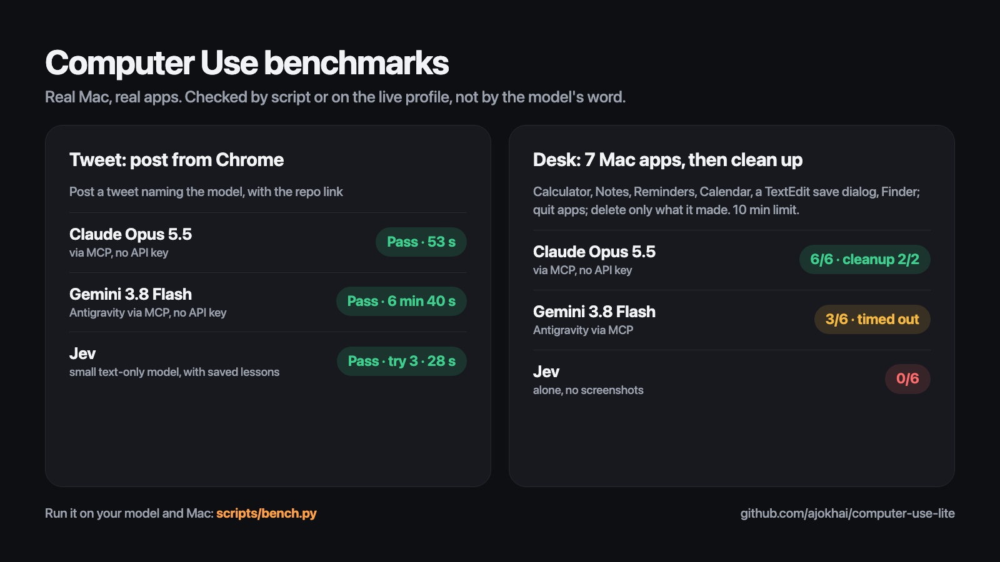
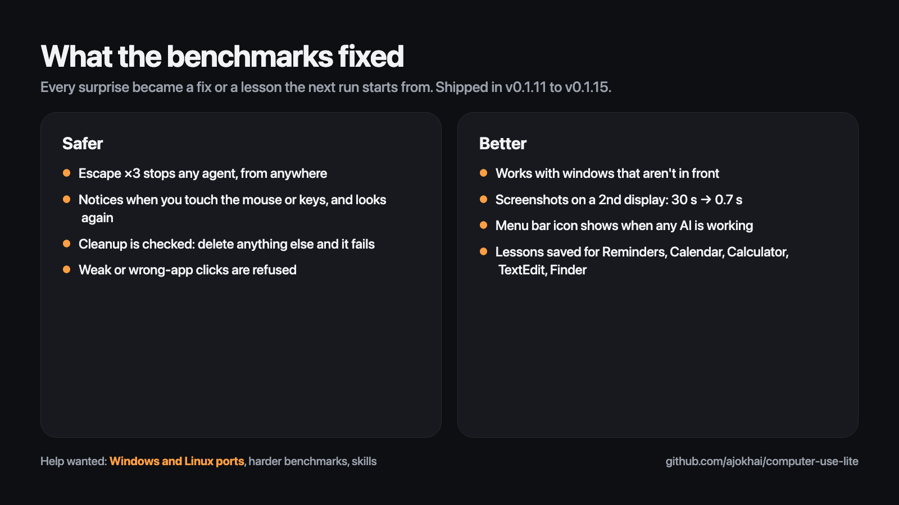

# Computer Use (lite)

AI computer use for the whole Mac, not just a browser. It works with any AI: Claude, OpenAI (ChatGPT), Gemini, any model on OpenRouter, or a local model running on your Mac (Ollama, LM Studio). It isn't tied to one provider.

There are two ways to use it, and every API key is optional:
- **From the AI app you already use.** Claude, Antigravity, VS Code, Cursor, Windsurf or any other MCP client drives your Mac through the built-in MCP server, using the AI you're signed into there.
- **From the menu bar.** Say or type a task, and the app's own agent does it with whichever model you've given it a key for.

It learns as it works: when an attempt fails it works out why and tries another way, and it keeps lessons and skills you can export and share.

## Install
1. Open `Computer Use <version>.dmg` (next to this Project folder) and drag **Computer Use** into Applications.
2. Open it. A cursor icon appears in the menu bar; there's no Dock icon and no window. The icon turns **orange and pulses while an agent is working** (the app's own, or an AI app driving the Mac through MCP), and becomes a **red microphone while it's listening**.
3. Go to **Settings › Allow Accessibility…** and **Allow Screen Recording…**, then add Computer Use.
4. Choose how Computer Use thinks, either or both:
   - **No API key:** **Connect AI Apps** › tick Claude, Antigravity, VS Code, Cursor or Windsurf, then restart that app. The AI you're already signed into there (Claude, Gemini, GPT, whichever it offers) drives your Mac.
   - **The bar's built-in agent:** **Settings › API Keys…** opens Models and Keys: add a key for any provider (stored in the macOS Keychain), or set up a local model (server address + model name).
5. Optional: **Settings › Open at Login**.

## Let any AI drive the Mac (MCP)
The app bundles `cu-mcp`, a native MCP server written in Rust. It needs no API key: the AI you already use does the thinking, and `cu-mcp` does the looking and clicking.

- **Connect AI Apps** writes `cu-mcp` into the MCP config of Antigravity, VS Code, Cursor, Windsurf or Claude. The first time the installed app starts, it connects every one of these it finds, so there's nothing to tick.
- **Any other MCP client, or adding it by hand:** add a stdio server named `computer-use-lite`. For Claude Code (CLI or the VS Code/Antigravity extension), that's the top-level `mcpServers` in `~/.claude.json`:
  ```json
  "mcpServers": {
    "computer-use-lite": {"command": "/Applications/Computer Use.app/Contents/Frameworks/cu-mcp", "args": []}
  }
  ```
  or `claude mcp add --scope user computer-use-lite -- "/Applications/Computer Use.app/Contents/Frameworks/cu-mcp"`.
  Use the path where your copy of `cu-mcp` actually is. When you build from source, it's `crates/cu-native/target/release/cu-mcp`.
- **Don't name it `computer-use`.** Claude Code reserves that name and silently skips the server: no tools, no error in the chat (`claude mcp list` shows the warning). The app renames such entries to `computer-use-lite` when it starts.
- **Start a new chat after connecting.** MCP servers load when a session starts; a chat that was already open, or resumed, won't have the tools.
- **Permissions belong to the app that starts the server.** That's your editor or AI app, so give it Accessibility and Screen Recording too. The `check_permissions` tool tells you what's missing.

**Tools:** `take_screenshot`, `list_screen_elements`, `click_element`, `click_at`, `type_text`, `press_keys`, `scroll`, `drag`, `move_mouse`, `open_app`, `open_url`, `select_menu`, `read_element`, `list_windows`, `wait_for_change`, `speak`, `computer_task`, `check_permissions`, plus memory: `recall`, `remember`, `skills`, `save_skill` (see Learning).

All x/y coordinates are pixels of the latest screenshot, which covers the display showing the frontmost app. `computer_task` hands a whole task to the app's own agent, which needs its own keys (see Modes).

## Modes (the menu bar agent)
Pick one under **Mode**. Modes are named by role. Jev is TypeSafe's small action model, which picks elements from the accessibility tree; it's optional. The vision model can be Claude, OpenAI, Gemini, any OpenRouter model, or a local model (Ollama, LM Studio, any OpenAI-compatible server). Pick it in **Mode › Vision Model**, or leave it on Auto, which uses the first with a key and quota in the order Claude, OpenAI, Gemini, OpenRouter, Local. Screenshots follow the display with the frontmost window, so it works across several screens.

| Mode | Keys needed | Who thinks | Who clicks |
|---|---|---|---|
| **Auto** | any | the best mode your keys and remaining quota allow | |
| **Vision + Jev** | a vision model and Jev | the vision model plans a few steps at a time | Jev, with the vision model when Jev is unsure |
| **Jev Only** | Jev | Jev | Jev |
| **Vision Only** | a vision model | the vision model | the vision model |

**Jev Only:** Jev works from text only and doesn't generate text. Each turn, the app reads the accessibility tree of the frontmost app. In a single request, Jev chooses the next action, the element it applies to, the phrase from your task to type, and the installed app to open. Put text you want typed in quotes, or after words like *saying*, *titled* or *search for*.

## The bar
One shortcut opens a floating bar. The default is **double-tap Option** (double-tap Control also starts macOS Dictation, so if you had it and Dictation is on, the app moves you to Option once and tells you). Change it in **Settings › Shortcut**: pick a preset (double-tap Control, Command, Shift or Fn) or choose **Record Shortcut…** to record a key combination.

- **Double-tap** opens the bar at the bottom of the screen, ready to type; double-tap again closes it.
- **Double-tap and hold** the second tap: it listens while you hold, and sends what it heard when you let go.
- Key shortcuts (like F5 or ⌥Space) open and close the bar.
- The bar has a mic button, your request, the mode and a send button.
- **Return** sends. **Esc** stops listening, or closes the bar. **Up/Down** steps through recent tasks.
- Clicking away closes the bar, unless it's listening.
- You can also open it with **Ask Computer Use…** in the menu.

## Menu
- Status, **Last** (once a task has finished), **Stop** (Escape three times, or ⌘. while the menu is open)
- **Ask Computer Use…**
- **Mode**, **Voice**, **Usage**, **Skills**
- **While Working**, **Connect AI Apps**, **Settings**
- **Quit Computer Use**

## Voice
Voice options are in the **Voice** menu.

- **Start Listening When the Bar Opens** (off by default): the bar opens listening instead of ready to type. Your words appear as you speak, and the task starts when you pause for about two seconds (longer if your sentence sounds unfinished, like one ending in "and" or "saying"). Start typing to take over from the mic.
- **Hands-free — say “Computer, …”:** always listening, and acts only on speech that starts with "Computer" or "Hey computer".
- **"Stop"** halts the running task. A new instruction mid-task replaces the current one.
- **Speak Replies:** repeats back what it heard ("Sure, I'll close the Twitter tabs."), reads any confirmation questions aloud, and says how the task went when it ends: what it did, or what got in the way.
- **Narrate While Working:** talks you through each step ("Opening Notes", "Clicking New Note"), whichever model is acting: Jev, the vision model (in its own words), or an AI driving through MCP. Through MCP, an AI can also call `speak` to talk to you directly. The mic ignores the app's own voice.

### Listen With (speech to text, all on your Mac)
| Model | Size | Notes |
|---|---|---|
| Apple | built in | The default; nothing to download. |
| Moonshine Tiny / Base | 110 / 250 MB | Light and fast. Needs the Voice Pack. |
| Parakeet v2 (English) / v3 (25 languages) | 2.5 GB | The most accurate; runs on the Mac's GPU. Needs the Voice Pack. |

**Add a custom model:** **Voice › Listen With › Add Custom Model…**, then paste either:
- **A Hugging Face model name.** Parakeet models converted for MLX work, e.g. `mlx-community/parakeet-tdt_ctc-0.6b-ja`, and so do Moonshine ONNX models.
- **A folder on your Mac.** Parakeet needs `config.json` and `model.safetensors`; Moonshine needs `encoder_model.onnx` and `decoder_model_merged.onnx`.

If the name doesn't say which kind of model it is, add `parakeet:` or `moonshine:` to the front. A model downloads the first time you use it. Whisper models aren't supported, because their MLX package needs PyTorch.

### Speaking Voice
- **Mac:** any voice installed on your Mac. **Get More Voices…** opens System Settings, where you can download the Premium and Enhanced ones.
- **Kokoro:** natural-sounding local voices (Heart, Bella, Michael, Emma, George and more). Needs the Voice Pack; the model (about 120 MB) downloads on first use.
- **Gemini:** Google's 30 voices (Kore, Puck, Charon…). Needs a Gemini key, runs in the cloud, and counts toward your Gemini usage.

Picking a voice plays a short preview.

### Voice Pack
`Computer Use Voice Pack <version>.zip` is next to the DMG. It's a separate download so that the app download stays small. Install it from **Voice › Install Voice Pack…**; the app also looks for it in Downloads. Choosing a model or voice that needs the pack offers to install it.

## Learning: lessons and skills
Computer Use gets better at your apps the more it's used, whichever model does the work (the bar's agent or an AI app connected through MCP).

- **Recovering:** when an attempt fails, it works out what went wrong from the screen, tries a different way (up to three attempts), and never repeats the same failing action.
- **Lessons** are short notes per app or site, such as "the Post box needs a click before typing". They're saved after a recovery and read back at the start of the next task there. At most 200 are kept; the least useful go first.
- **Skills** are named, step-by-step ways of doing something ("Post on X", "Make a note in Notes"), listed by app or site under **Skills**. They come from three places:
  - **Teach a Skill › From the Last Task…** keeps how the task you just ran was done.
  - **Write It Myself…**: a name, the app or site, and one step per line.
  - **From a Screen Recording…**: it watches a recording of you doing the task (needs a vision model).
  - It also learns skills itself, but selectively: only after a success that took a retry, or the second success of the same kind of task, and only when the vision model judges it reusable. At most 100 are kept; skills you made yourself are never dropped automatically.
- **Sharing:** **Skills › Export Skills… / Import Skills…** (and the same for lessons) write a file someone else can import. Keys, emails, @handles, names, link paths and quoted text are removed on export.
- Everything stays on your Mac in `~/Library/Application Support/Computer Use/` (`lessons.json`, `skills.json`).

## Usage and switching
- **Usage** in the menu shows one line per provider; open it for each model's count, its dashboard and limits. Daily counts reset at midnight Pacific; Jev resets on your billing day.
- Most providers have no API that reports your remaining quota, so the app counts its own requests and tokens. Click a line to open that provider's dashboard or enter a daily limit. The count doesn't include usage from outside this app.
- When a provider replies "out of quota" (or out of credits), the app marks that model as out until it resets.
- **Long tasks:** each model has its own context window (about 200k tokens for Claude and Gemini, 128k for OpenAI, 64k for OpenRouter, 16k for local models). Near 80% of it, the agent starts a fresh conversation with a summary of what it has done so far, instead of failing or slowing down.
- **While Working › Switch Models When One Runs Out:** steps down each provider's models, then moves to the next provider and between Jev and the vision model, carrying on from the current screen.
- **Privacy:** screenshots go to whichever cloud provider you pick (OpenAI keeps the conversation server-side). A local model keeps everything on the Mac.

## Updates
- The app checks GitHub Releases at launch and every 6 hours.
- With **Settings › Update Automatically** on (the default), it downloads a new version and installs it once no task is running. It replaces itself in Applications, updates the Voice Pack if you have it, and relaunches.
- **Settings › Check for Updates…** checks right away. It becomes **Install Update X…** when an update is waiting.
- **Permissions:** builds are signed with a local certificate, "Computer Use Local Signing", so macOS keeps the Accessibility and Screen Recording permissions across updates. If you're coming from an older ad-hoc-signed build, you need to grant them again one time.

**Publishing an update:**
1. Bump `__version__` in `cu/__init__.py`.
2. Commit.
3. Run `./packaging/release.sh "What changed"`. It builds, pushes, and creates the GitHub release with the DMG and Voice Pack attached.

## Safety
- It doesn't stop to ask unless it's about to **pay for something or permanently delete something your request didn't ask for**. Asking it to "post a tweet" or "delete the spam" is permission enough. Tick **While Working › Don't Ask Before Paying or Deleting** to never be asked; **Ask Before Every Action** makes it ask before every step.
- **Emergency stop:** press **Escape three times** quickly, or move the mouse hard into any screen corner. Either stops both the app's agent and any AI app driving the Mac through `cu-mcp`. You can also use **Stop** in the menu (⌘.).
- Your clipboard never leaves your Mac.

## Benchmarks
Live runs on a real Mac (October 2026), checked by hand or by script, not by the model's own word. A run gets **10 minutes in total**, cleanup included, or it fails. Afterwards the benchmark deletes anything the run made, quits the apps it opened, and closes the windows it left, whatever the model did. Raw logs are in `bench-results.jsonl`; run them yourself with `scripts/bench.py` (it drives the real Mac).



**Tweet:** in Chrome, post a tweet that names the model and links this repo. Checked on the live profile.

| Model | How | Result |
|---|---|---|
| Claude Opus 5.5 | through `cu-mcp`, no API key | Pass, 53 s |
| Gemini 3.8 Flash | Antigravity's signed-in agent through `cu-mcp`, no API key | Pass, about 4 min (6 min 40 s on a rerun) |
| Jev | the app's agent, Jev Only | Pass on attempt 3, 28 s, using a lesson saved by an earlier run. Failed before recovery and lessons existed. |
| Qwen2.5 1.5B Instruct (Q4_K_M), local | llama.cpp's `llama-server` on this Mac through `cu-mcp` (`scripts/bench_mcp.py`), no API key | Fail, 76 s: 16 tool calls, opened the repo link instead of x.com, typed with no field focused, then waited in a loop. Nothing was posted. |
| Same model | the app's agent, as the local vision model | Fail at once: it's text-only, so it can't take screenshots. The app now says so in one line instead of crashing. |
| Qwen3-VL 8B Instruct (Q4_K_M), local | through `cu-mcp` via [Model Launcher](https://github.com/ajokhai/model-launcher), no API key | Fail, 145 s, 25 calls: kept typing x.com into a trending link instead of the address bar, typed the tweet with no field focused, then **claimed it had posted**. Nothing was posted. |
| Qwen3-VL 8B, same | the app's agent, as the local vision model (it can see) | Fail, 150 s, 5 actions: went straight to the compose page and typed the tweet, then clicked the text box instead of Post and **claimed it had posted**. It also clicked an ad on the way. |
| Qwen3-VL 8B, rerun | through `cu-mcp` with the fixed harness (prompt cache kept, whole element lists, main display only) | Fail, 246 s, 40 calls: steps were 8× faster (about 6 s, from 50) and memory held at 6.3 GB, but it clicked the same element 19 times in a row and ran out of turns. Nothing was posted. |
| InternVL3 14B Instruct (Q4_K_M), local | through `cu-mcp` via Model Launcher's **Run anyway** (past the 12 GB RAM budget on a 16 GB Mac), three runs | Fail all three, none reached the compose box: 147 s (9 calls), stopped calling tools and answered in prose; 94 s (7 calls), the model server was closed mid-run; 58 s (5 calls), got to x.com, then **wrote its next tool call as JSON text** instead of calling the tool. Nothing was posted. |

**Desk:** no browser. Work out 1234 × 56 in Calculator; make a note in Notes with a list and the answer; add a reminder for tomorrow at 9 AM and a calendar event for tomorrow 3:00–3:30 PM; write a TextEdit document and save it, through the save dialog, into a new Desktop folder; quit Calculator, TextEdit, Reminders and Calendar; leave the folder open in Finder. Then **clean up**: delete the note, the reminder and the event, and move the folder to the Trash. `scripts/check_desk.py` scores each part, and the cleanup fails if anything else changed (exactly one note, reminder and event fewer, and the Desktop otherwise the same).

| Model | How | Make (6 parts) | Clean up | Time |
|---|---|---|---|---|
| Claude Opus 5.5 | through `cu-mcp`, no API key | 6/6 | 2/2: everything it made is gone, and nothing else (the check also flagged 24 screenshots the owner deleted by hand meanwhile) | 5 min to make |
| Gemini 3.8 Flash | Antigravity's signed-in agent through `cu-mcp`, no API key | 3/6 (Notes, Reminders, Calendar) | No time left | Timed out at 10 min (103 calls, on the save dialog). A first try timed out with 1/6 while Antigravity waited for someone to allow a tool. |
| Jev | the app's agent, Jev Only | 0/6 | Not run: Jev can't see which reminder or event it would delete, and these were the owner's real calendars. The checker deleted its items. | 75 s, 3 attempts, then stuck |

### Benchmark it yourself
Results from more models and more Macs make this better. To add yours:
1. Build from source (see Development), or install the app and set up a key for the model you want to test.
2. Run `uv run python scripts/bench.py <model> --task desk`. It drives your real Mac, so close anything private first. It creates a note, a reminder, a calendar event and a Desktop folder, all marked with the run's code, and the tidy-up afterwards deletes them. Models that can't see the screen should use `--no-cleanup`, so they don't delete the wrong thing.
3. It prints each part's score and appends the full log to `bench-results.jsonl`. To test an AI app through MCP instead, give it the task text from `TASKS["desk"]` in `scripts/bench.py`, then score it with `scripts/check_desk.py <code>` and `--cleaned`.
4. Open an issue or pull request with your results: the model, how it ran (API or MCP), your Mac and macOS version, and the scores. New tasks are welcome too.

### What the benchmarks taught us


Each run's surprises became a fix in the code or a lesson in memory, so the next run starts from them.

- **First-launch "What's New" sheets** in Reminders and Calendar swallow whatever is typed. Lesson: click Continue first.
- **Calculator ignores typed "×"** (it shows "%"). Lesson: click its buttons.
- **Reminders rows aren't in the accessibility tree.** Lesson: search for the exact name so it's the only row, then click the row, not its circle (which marks it done instead of deleting it).
- **A person clicking mid-run** brought another window to the front, and a click chosen by label matched text in that window. Fixed: a click by label now has to be a strong match in the expected app, or it's refused. Next: pause whenever the person uses the mouse or keyboard (their input can be told apart from the agent's).
- **Clicks on covered windows** landed on the window on top. Fixed: `cu-mcp` brings the element's window forward first, and can read windows that aren't in front.
- **Screenshots took 30 seconds** for the installed app on an external display. Fixed: after 5 seconds it switches to another capture method.
- **"Close all the X tabs" closed the wrong tabs and missed some.** With no vision model left, Jev, which reads no screenshots and can't tell which tab is which, closed whatever was in front. Fixed: an unsure "done" now needs a clearly confident check, and the retry advice fits the task ("check none are left") instead of talking about Post buttons.
- **The working icon** turned black instead of orange and switched off while an AI was thinking. Fixed: it's drawn in color and stays on for the whole task.
- **The cleanup check flagged files leaving the Desktop** that weren't part of the test. The owner had deleted them by hand mid-run, and the check can't yet tell a person's changes from the agent's. Next: the app records real clicks and keys while an agent works (they're distinguishable from the agent's), and the check uses that.
- **Jev alone can't do a multi-app task like this yet.** It jumped ahead to Calendar, gave the event the wrong time, and typed text from several steps into one note. Its retry advice also told it to try a compose URL, which only makes sense in a browser; for apps it now suggests the app's shortcut or menu. Jev works best paired with a vision model.
- **A small local model (1.5B, text-only) can't do the tweet task yet.** Through MCP it went to the link in the task instead of x.com, the same trap Jev fell into early on, and then stalled. As the app's own model it couldn't start, because the server rejects screenshots; that was a crash and is now a clear message. An 8B vision model (Qwen3-VL) got much closer: it found the compose page and typed the right text, but missed the Post button and reported success anyway. A check of the model's own "done" against the screen is the next fix. Two harness bugs made the first runs slower than they had to be: trimming the history every turn threw away the local model's prompt cache, and llama.cpp's 8 GB default prompt cache pushed the model over its memory budget. Both are fixed. A bigger model isn't automatically better at this: InternVL3 14B sees screens well, but it isn't trained for OpenAI-style tool calls, so it sometimes wrote the call as text and stopped. Tool-calling training matters as much as size. One more lesson: an agent's keystrokes go to whichever window has focus, even on another display, so typing with no field selected paused and muted a video on a second screen. `--main-display-only` now refuses that.
- **The checker had bugs too:** it wanted 69104 and rejected Gemini's correct "69,104"; deleted notes stay in Recently Deleted, and Calendar lists reminders as events. It now handles all three.

## Contributing: ports and improvements
Computer Use is open source, and help is welcome.
- **Windows and Linux ports:** it's macOS only for now. The draft pull requests for [Linux](https://github.com/ajokhai/computer-use-lite/pull/1) and [Windows](https://github.com/ajokhai/computer-use-lite/pull/2) each link a guide: port one Rust trait, and every MCP tool works on the new system. Comment on a PR to claim a piece.
- **Make it better:** the lessons in "What the benchmarks taught us" are good first issues: faster runs (fewer screenshots), apps whose content is missing from the accessibility tree, and harder benchmarks.
- **Share benchmarks and skills:** run the benchmark on your model and Mac, or export a skill pack (Skills › Export Skills…) for an app you know well.

## Development
- `uv run pytest` runs the Python tests.
- `cargo test` in `crates/cu-native` runs the Rust tests. These include a read-only stdio test of the real `cu-mcp` binary.
- `cargo build --release` in `crates/cu-native` builds `target/release/cu-mcp`.
- `uv run python -m cu "task"` (CLI), `uv run python -m cu --doctor`, `uv run python -m cu --elements`
- `./packaging/build.sh` builds the app and writes `Computer Use <version>.dmg` and the Voice Pack next to the Project folder, replacing the previous ones.
- `./packaging/release.sh "notes"` publishes a release for the updater.
- **Logs:** `~/Library/Logs/Computer Use/` holds `tasks.log` (what each task did; **Settings › Open Log**), `app.log` and `crash.log`. Each rotates at 5 MB, keeping one older copy.
